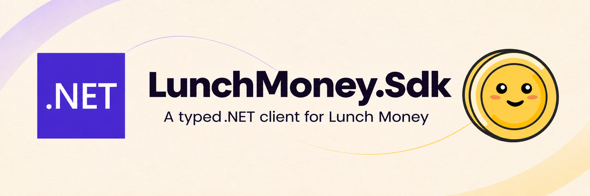

<p align="center">
  
</p>

<p align="center">
  <strong>Lunch Money's API, ready for your .NET application.</strong><br />
  Typed requests, familiar dependency injection, and a factory for background work.
</p>

<p align="center">
  <a href="https://dotnet.microsoft.com/"></a>
  <a href="https://lunchmoney.dev/v2/docs"></a>
  <a href="https://learn.microsoft.com/openapi/kiota/"></a>
  <a href="#injection-options"></a>
  <a href="https://github.com/brunofelixns/LunchMoney.Sdk/blob/main/LICENSE"></a>
</p>

<p align="center">
  <a href="#quickstart">Quickstart</a> &nbsp;·&nbsp;
  <a href="#configuration">Configuration</a> &nbsp;·&nbsp;
  <a href="#injection-options">Injection options</a> &nbsp;·&nbsp;
  <a href="#background-workers">Background workers</a> &nbsp;·&nbsp;
  <a href="#error-handling">Error handling</a> &nbsp;·&nbsp;
  <a href="#regeneration">Regeneration</a>
</p>

---

| Typed by Kiota | Built for dependency injection | Ready for background work |
| :--- | :--- | :--- |
| Fluent clients and models generated from the Lunch Money v2 OpenAPI specification. | One registration for configuration, authentication and HTTP customization. | A singleton factory that creates a configured SDK client for each operation. |

## Quickstart

Install the package in a .NET 11 application:

```powershell
dotnet add package LunchMoney.Sdk --version 0.1.0
```

Version `0.1.0` is the initial package version prepared by this repository. Until
it is published to NuGet.org, download the package from a successful
[CI run](https://github.com/brunofelixns/LunchMoney.Sdk/actions/workflows/ci.yml)
and place `LunchMoney.Sdk.0.1.0.nupkg` in a `local-feed` directory in the consuming
project. Add a `NuGet.Config` beside that application's project file:

```xml
<?xml version="1.0" encoding="utf-8"?>
<configuration>
  <packageSources>
    <clear />
    <add key="LunchMoneyLocal" value="./local-feed" />
    <add key="nuget.org" value="https://api.nuget.org/v3/index.json" />
  </packageSources>
</configuration>
```

Then run from the consuming project:

```powershell
dotnet add package LunchMoney.Sdk --version 0.1.0 --no-restore
dotnet restore
```

The local feed supplies the SDK; NuGet.org supplies its transitive dependencies.
If your application already has a `NuGet.Config`, add the local source to its
existing sources instead of replacing that configuration.

Register the SDK in
`Program.cs` before `builder.Build()`. Both injection styles below use this same
registration; call `AddLunchMoney` once per application:

```csharp
using LunchMoney.Sdk;
using Microsoft.Extensions.DependencyInjection;

builder.Services
    .AddLunchMoney(builder.Configuration.GetSection("LunchMoney"))
    .ConfigureHttpClient(http => http.Timeout = TimeSpan.FromSeconds(30));
```

`AddLunchMoney` registers `LunchMoneyClient` as a transient typed client and
`ILunchMoneyClientFactory` as a singleton. They share the same HTTP configuration,
authentication and Kiota middleware.

> **One registration, two ways to use it.** Inject `LunchMoneyClient` in regular
> services, or `ILunchMoneyClientFactory` when you need to create a client per operation.

## Configuration

| Setting | Required | Default |
| :--- | :---: | :--- |
| `LunchMoney:Token` | Yes | Your access token, without the `Bearer` prefix. |
| `LunchMoney:BaseUrl` | No | `https://api.lunchmoney.dev/v2` |

In the **consuming application's** `appsettings.json`:

```json
{
  "LunchMoney": {
    "BaseUrl": "https://api.lunchmoney.dev/v2"
  }
}
```

`BaseUrl` is optional and defaults to the URL above. It must be an absolute HTTPS
URL, including the API version, without credentials, a query string or a fragment.
A trailing slash is accepted.

### Local development

Set the token in the **consuming project**, without the `Bearer` prefix. For local
development, use user secrets in the consuming ASP.NET Core or Worker project:

```powershell
dotnet user-secrets init
dotnet user-secrets set "LunchMoney:Token" "YOUR_ACCESS_TOKEN"
```

The examples use `WebApplication.CreateBuilder` or `Host.CreateApplicationBuilder`,
which load the project's user secrets automatically in the `Development`
environment. Use `dotnet run --environment DOTNET_ENVIRONMENT=Development` when
running locally if the launch profile does not already select that environment.

### Deployment

For deployments, supply the `LunchMoney__Token` environment variable through your
deployment's secret configuration. You can override the URL with
`LunchMoney__BaseUrl`. Do not commit real tokens to configuration files.

<details>
<summary>Configure options in code instead</summary>

Alternatively, configure the options directly:

```csharp
builder.Services.AddLunchMoney(options =>
{
    options.BaseUrl = "https://api.lunchmoney.dev/v2";
    options.Token = builder.Configuration["LunchMoney:Token"]!;
});
```

</details>

<details>
<summary>How registration and validation work</summary>

Both overloads return `IHttpClientBuilder`, allowing further `ConfigureHttpClient`,
`AddHttpMessageHandler` and transport configuration. Internally, `AddLunchMoney`
uses `AddHttpClient<LunchMoneyClient>`: `IHttpClientFactory` creates the HTTP
client and supplies it to the custom constructor alongside
`IOptions<LunchMoneyOptions>`. Registration retains Kiota's default middleware,
including retries.
Invalid settings fail at host startup, or when the client is resolved from a
standalone service provider. Settings are read through `IOptions<LunchMoneyOptions>`;
restart the application after changing its connection settings.

</details>

## Injection options

Choose the dependency that fits the lifetime of your consumer. Both use the
same registration and connection settings.

| Consumer | Inject | Usage |
| :--- | :--- | :--- |
| A scoped or transient application service | `LunchMoneyClient` | Call the SDK directly. |
| A singleton, scheduled job or `BackgroundService` | `ILunchMoneyClientFactory` | Call `CreateClient()` for each operation. |

## Direct client injection

Use direct client injection in scoped or transient services. This complete
ASP.NET Core `Program.cs` registers the SDK and a service, then exposes an endpoint
that uses that service:

```csharp
using LunchMoney.Sdk;
using Microsoft.Extensions.DependencyInjection;

var builder = WebApplication.CreateBuilder(args);

builder.Services
    .AddLunchMoney(builder.Configuration.GetSection("LunchMoney"))
    .ConfigureHttpClient(http => http.Timeout = TimeSpan.FromSeconds(30));

builder.Services.AddScoped<CategoryService>();

var app = builder.Build();

app.MapGet("/categories/count", async (
    CategoryService service,
    CancellationToken cancellationToken) =>
    Results.Ok(await service.CountAsync(cancellationToken)));

app.Run();
```

In `CategoryService.cs`, inject the configured SDK client through its constructor:

```csharp
using LunchMoney.Sdk;

public sealed class CategoryService(LunchMoneyClient client)
{
    public async Task<int> CountAsync(CancellationToken cancellationToken = default)
    {
        var response = await client.Categories.GetAsync(
            cancellationToken: cancellationToken);
        return response?.Categories?.Count ?? 0;
    }
}
```

`AddScoped<CategoryService>()` creates your service per HTTP request. You can use
`AddTransient<CategoryService>()` instead when appropriate. `AddLunchMoney` already
registers the SDK client; do not register `LunchMoneyClient` separately. Avoid
keeping the transient SDK client in a singleton; inject the factory instead.

> **Authentication is included.** The token is sent as
> `Authorization: Bearer <token>` only to the configured host.

<details>
<summary>Advanced: construct the client manually</summary>

Registration, options and authentication configuration live outside `Generated`,
so regenerating the client does not overwrite them. You can also construct
`LunchMoneyClient` with an `HttpClient` and `IOptions<LunchMoneyOptions>`, or
continue using the generated `IRequestAdapter` constructor. When constructing
the client manually, the caller configures the HTTP transport, middleware and
option validation; use `AddLunchMoney` to get those defaults together.

</details>

## Background workers

`AddLunchMoney` also registers `ILunchMoneyClientFactory` as a singleton. Inject
the factory into singleton services, including a `BackgroundService`, and call
`CreateClient()` for each operation. Each call creates a new configured SDK client
through `IHttpClientFactory`, using the same options, HTTP customizations, Kiota
handlers and host-restricted authentication as direct typed injection. The
factory does not retain HTTP or SDK clients.

For a standalone Worker application, use this `Program.cs`. Its `LunchMoney`
configuration and token setup are the same as above:

```csharp
using LunchMoney.Sdk;
using Microsoft.Extensions.DependencyInjection;
using Microsoft.Extensions.Hosting;

var builder = Host.CreateApplicationBuilder(args);

builder.Services
    .AddLunchMoney(builder.Configuration.GetSection("LunchMoney"))
    .ConfigureHttpClient(http => http.Timeout = TimeSpan.FromSeconds(30));

builder.Services.AddHostedService<LunchMoneyWorker>();

await builder.Build().RunAsync();
```

In `LunchMoneyWorker.cs`, inject the SDK factory and create the client inside
each iteration. This read-only polling example logs recoverable failures,
waits before trying again, and exits normally when the host cancels its token:

```csharp
using LunchMoney.Sdk;
using System.Net.Http.Headers;
using Microsoft.Extensions.Hosting;
using Microsoft.Extensions.Logging;
using Microsoft.Kiota.Abstractions;

public sealed class LunchMoneyWorker(
    ILunchMoneyClientFactory clientFactory,
    ILogger<LunchMoneyWorker> logger) : BackgroundService
{
    private static readonly TimeSpan RecoveryDelay = TimeSpan.FromSeconds(30);

    protected override async Task ExecuteAsync(CancellationToken stoppingToken)
    {
        try
        {
            while (!stoppingToken.IsCancellationRequested)
            {
                var nextRunDelay = TimeSpan.FromMinutes(5);
                try
                {
                    var client = clientFactory.CreateClient();
                    var response = await client.Categories.GetAsync(
                        cancellationToken: stoppingToken);

                    logger.LogInformation("Lunch Money returned {CategoryCount} categories",
                        response?.Categories?.Count ?? 0);
                }
                catch (ApiException error) when (IsRecoverable(error))
                {
                    nextRunDelay = GetRetryDelay(error);
                    logger.LogWarning("Lunch Money returned HTTP {Status}; retrying in {Delay}.",
                        error.ResponseStatusCode, nextRunDelay);
                }
                catch (AggregateException error) when (IsRecoverableRetryFailure(error))
                {
                    var lastError = (ApiException)error.Flatten().InnerExceptions[^1];
                    nextRunDelay = GetRetryDelay(lastError);
                    logger.LogWarning("Lunch Money retries exhausted (HTTP {Status}); retrying in {Delay}.",
                        lastError.ResponseStatusCode, nextRunDelay);
                }
                catch (HttpRequestException error)
                {
                    nextRunDelay = RecoveryDelay;
                    logger.LogWarning("Lunch Money connection failed ({Error}); retrying in {Delay}.",
                        error.HttpRequestError, nextRunDelay);
                }
                catch (OperationCanceledException) when (!stoppingToken.IsCancellationRequested)
                {
                    nextRunDelay = RecoveryDelay;
                    logger.LogWarning("Lunch Money request timed out; retrying in {Delay}.", nextRunDelay);
                }

                await Task.Delay(nextRunDelay, stoppingToken);
            }
        }
        catch (OperationCanceledException) when (stoppingToken.IsCancellationRequested)
        {
            // Normal shutdown, including cancellation during HTTP or a retry delay.
        }
    }

    private static bool IsRecoverable(ApiException error) =>
        error.ResponseStatusCode is 408 or 429 or >= 500 and <= 599;

    private static bool IsRecoverableRetryFailure(AggregateException error)
    {
        var failures = error.Flatten().InnerExceptions;
        return failures.Count > 0 && failures.All(failure =>
            failure is ApiException apiError && IsRecoverable(apiError));
    }

    private static TimeSpan GetRetryDelay(ApiException error)
    {
        var header = error.ResponseHeaders.FirstOrDefault(entry =>
            entry.Key.Equals("Retry-After", StringComparison.OrdinalIgnoreCase)).Value?.FirstOrDefault();
        if (!RetryConditionHeaderValue.TryParse(header, out var retryAfter))
            return RecoveryDelay;

        var requestedDelay = retryAfter.Delta ?? (retryAfter.Date - DateTimeOffset.UtcNow) ?? TimeSpan.Zero;
        return requestedDelay > RecoveryDelay ? requestedDelay : RecoveryDelay;
    }
}
```

The example continues after HTTP `408`, `429`, `5xx`, exhausted transient retries,
network failures and timeouts. It waits at least 30 seconds after a failure and
honors a longer `Retry-After` value (seconds or HTTP date). A successful poll waits
five minutes. These intervals are example application policy, not SDK defaults.

Permanent errors such as `400` or `401`, invalid SDK settings and unexpected
programming failures are allowed to reach the host. This keeps those problems
visible rather than repeatedly treating them as transient. The loop polls with
`GET`; choose retry and idempotency behavior explicitly when adapting it to writes.

To host the worker inside the ASP.NET Core application instead, add
`builder.Services.AddHostedService<LunchMoneyWorker>()` before `builder.Build()`
in that application's `Program.cs`, using the same SDK registration.

The worker does not need options, a client name, adapter construction or an
application DI scope just to use the SDK. Keep the returned client local to the
operation. If the operation also uses scoped application services, such as an
EF Core `DbContext`, resolve those services in a scope as usual.

## Error handling

The SDK propagates failures to the caller's `await`. Direct injection and the
client factory use the same exception behavior; registration does not install an
application-wide exception handler.

| Failure | What the caller receives |
| :--- | :--- |
| HTTP error with a generated mapping | `ErrorResponseObject`, derived from `ApiException`, with status, message, headers and `Errors`. Mappings depend on the endpoint. |
| HTTP error without a mapping | `ApiException`, with `ResponseStatusCode` and `ResponseHeaders`. |
| Kiota retry budget exhausted | `AggregateException` containing the HTTP failures as `ApiException` entries. |
| Connection failure | `HttpRequestException`. |
| HTTP timeout or caller cancellation | `OperationCanceledException`; check the caller token to distinguish shutdown from timeout. |
| Missing or invalid SDK settings | `OptionsValidationException` during host startup or client creation. |

The default Kiota retry handler retries `429`, `503` and `504`. Exhaustion in the
current Kiota version produces an aggregate, so catching only `ApiException` is
not enough for a resilient worker. Inner retry error messages can include response
bodies; the example logs status and timing rather than dumping those exceptions.

In ASP.NET Core, handle failures in the consuming service or an application
exception handler. In a `BackgroundService`, catch recoverable failures inside the
loop as shown above. An unhandled background exception stops the host by default;
setting `BackgroundServiceExceptionBehavior.Ignore` does not restart a failed loop.

See [Kiota error handling](https://learn.microsoft.com/openapi/kiota/errors),
[Kiota's retry handler](https://github.com/microsoft/kiota-dotnet/blob/main/src/http/httpClient/Middleware/RetryHandler.cs),
and [.NET background exception behavior](https://learn.microsoft.com/dotnet/core/compatibility/core-libraries/6.0/hosting-exception-handling).

## Regeneration

```powershell
dotnet tool restore
dotnet tool run kiota update -o ./Generated --clean-output
```

Kiota may delete and recreate everything inside `Generated`, including
`LunchMoneyClient.cs`. Keep custom code outside that directory:

```text
LunchMoneyOptions.cs                     # Custom settings
LunchMoneyServiceCollectionExtensions.cs # Custom registration
LunchMoneyClient.Extensions.cs           # Partial constructor and authentication
ILunchMoneyClientFactory.cs              # Factory contract for consumers
LunchMoneyClientFactory.cs               # Creates configured clients per operation
Generated/                              # Replaced by Kiota
```

`LunchMoneyClient.Extensions.cs` adds a constructor through a
`partial class LunchMoneyClient` in the `LunchMoney.Sdk` namespace. It creates
the adapter and calls the generated constructor without editing generated files.
The constructor is marked with `ActivatorUtilitiesConstructor` so typed client
registration selects it explicitly. Use the same class name and namespace when
regenerating, and run the tests afterward to detect API changes.
The local tool manifest pins Kiota to the version used by the generated client.
The specification URL in `Generated/kiota-lock.json` follows the upstream `latest`
specification, so regeneration can change the API surface. Review those changes
and update the package version when appropriate; CI builds the committed sources.

## Development

```powershell
dotnet restore LunchMoney.Sdk.slnx --locked-mode
dotnet build LunchMoney.Sdk.slnx -c Release --no-restore
dotnet test tests/LunchMoney.Sdk.Tests/LunchMoney.Sdk.Tests.csproj -c Release --no-build --no-restore
dotnet pack LunchMoney.Sdk.csproj -c Release --no-build --no-restore -o artifacts/packages
```

The integration tests use an in-memory HTTP transport and synthetic tokens. They
do not call Lunch Money. Error coverage exercises both injection styles, including
mapped/unmapped responses, malformed error JSON, retry recovery and exhaustion,
`Retry-After` seconds/dates, connection failure, timeout and cancellation before or
during HTTP and during retry delays.

`global.json` selects .NET SDK `11.0.100` with servicing patch updates allowed.
Commit both `packages.lock.json` files. After intentionally changing dependencies,
run `dotnet restore LunchMoney.Sdk.slnx --force-evaluate` and review the lock-file diff.

### CI and packages

[GitHub Actions](https://github.com/brunofelixns/LunchMoney.Sdk/actions/workflows/ci.yml)
runs locked restore, a Release build with warnings treated as errors, all tests
and packing on Windows and Linux for pushes to `main`, pull requests and manual
runs. Each successful job uploads a `.nupkg`, a `.snupkg` and a test report.
Artifacts expire after 14 days. No Lunch Money token is needed.

The NuGet package includes the README, MIT license, third-party notices and XML
API documentation. The symbol package contains portable PDBs; builds from a Git
checkout use the .NET SDK's built-in Source Link support for source debugging.

### Publishing a release

The CI validates and packages the SDK. To publish a release, choose the version in
`LunchMoney.Sdk.csproj`, merge and verify that commit's CI, then download one
successful job's package artifact. Publish the `.nupkg` using NuGet.org's upload
page or `dotnet nuget push` with your own publishing credentials. The companion
`.snupkg` enables symbol publishing. Package versions cannot be overwritten on
NuGet.org; retain the exact commit used to build each release.

Before the first release, upload the repository contents to `main` so the README
banner's public URL is available. The shared README uses absolute GitHub URLs
and image hosts supported by NuGet.org.

## License

The SDK is licensed under [MIT](https://github.com/brunofelixns/LunchMoney.Sdk/blob/main/LICENSE).
It is a community project, independent of Lunch Money and Microsoft. Brand assets
and dependency licenses are covered by the
[third-party notices](https://github.com/brunofelixns/LunchMoney.Sdk/blob/main/THIRD-PARTY-NOTICES.md).

## Resources

- [Lunch Money developer documentation](https://lunchmoney.dev/introduction)
- [Lunch Money v2 API reference](https://lunchmoney.dev/v2/docs)
- [Microsoft Kiota documentation](https://learn.microsoft.com/openapi/kiota/)
- [IHttpClientFactory in .NET](https://learn.microsoft.com/dotnet/core/extensions/httpclient-factory)
- [Issues and feedback](https://github.com/brunofelixns/LunchMoney.Sdk/issues)
- [Header artwork and brand references](https://github.com/brunofelixns/LunchMoney.Sdk/blob/main/docs/assets/README.md)

---

<p align="center">
  <sub>Built with <a href="https://dotnet.microsoft.com/">.NET</a>,
  <a href="https://learn.microsoft.com/openapi/kiota/">Microsoft Kiota</a>
  and the <a href="https://lunchmoney.app/">Lunch Money</a> API.</sub>
</p>
