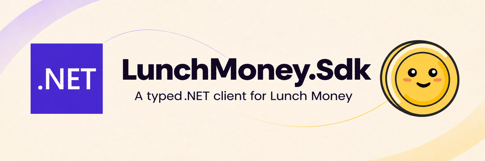

<p align="center">
  
</p>

<p align="center">
  <strong>La API de Lunch Money, lista para tu aplicación .NET.</strong><br />
  Peticiones tipadas, inyección de dependencias y una factory para tareas en segundo plano.
</p>

<p align="center">
  <a href="https://github.com/brunofelixns/LunchMoney.Sdk/actions/workflows/ci.yml"></a>
  <a href="https://dotnet.microsoft.com/"></a>
  <a href="https://lunchmoney.dev/v2/docs"></a>
  <a href="https://github.com/brunofelixns/LunchMoney.Sdk/blob/main/LICENSE"></a>
</p>

<p align="center">
  <a href="../../README.md">English</a> · <strong>Español</strong> · <a href="../README.md">Índice en inglés</a>
</p>

## Inicio rápido

Necesitas **.NET 11**. Descarga el paquete inicial `0.1.0` de los
[artefactos de CI](https://github.com/brunofelixns/LunchMoney.Sdk/actions/workflows/ci.yml)
y sigue la [guía de instalación desde un origen local](getting-started.md).
Cuando se publique en NuGet.org, podrás instalarlo con:

```powershell
dotnet add package LunchMoney.Sdk --version 0.1.0
```

Define `LunchMoney:Token` en los secretos de usuario de tu aplicación o utiliza
la variable de entorno `LunchMoney__Token`. Proporciona el token sin `Bearer`.
La URL predeterminada es `https://api.lunchmoney.dev/v2`.
Consulta [Configuración](configuration.md) para definir los secretos y conocer
la validación de opciones.

En el `Program.cs` de una aplicación ASP.NET Core:

```csharp
using LunchMoney.Sdk;
using Microsoft.Extensions.DependencyInjection;

var builder = WebApplication.CreateBuilder(args);

builder.Services
    .AddLunchMoney(builder.Configuration.GetSection("LunchMoney"))
    .ConfigureHttpClient(http => http.Timeout = TimeSpan.FromSeconds(30));

var app = builder.Build();

app.MapGet("/categories/count", async (
    LunchMoneyClient client, CancellationToken cancellationToken) =>
{
    var response = await client.Categories.GetAsync(cancellationToken: cancellationToken);
    return Results.Ok(response?.Categories?.Count ?? 0);
});

app.Run();
```

El mismo registro admite las dos formas de inyección:

| Consumidor | Dependencia |
| :--- | :--- |
| Servicio scoped o transitorio | `LunchMoneyClient` |
| Singleton o `BackgroundService` | `ILunchMoneyClientFactory`; llama a `CreateClient()` por operación |

Ambas comparten la configuración de `IHttpClientFactory`, la autenticación
limitada al host y el middleware de Kiota. El código de integración está fuera de
`Generated`, por lo que se conserva al regenerar el cliente.

## Documentación

| Guía | Contenido |
| :--- | :--- |
| [Primeros pasos](getting-started.md) | Instalación, artefactos de CI y orígenes locales. |
| [Configuración](configuration.md) | Token, secretos de usuario, variables de entorno y validación. |
| [Inyección de dependencias](dependency-injection.md) | Cliente tipado, factory y ejemplos completos de ASP.NET Core. |
| [Servicios en segundo plano](background-services.md) | Worker completo con recuperación, esperas y apagado ordenado. |
| [Gestión de errores](error-handling.md) | Errores HTTP, reintentos, timeout y cancelación. |
| [Desarrollo](development.md) | Kiota, compilación, tests, CI, empaquetado y publicación. |
| [Arquitectura](architecture.md) | Ciclos de vida HTTP, factory para servicios en segundo plano y separación del código generado. |

Cada guía tiene un enlace a su versión en inglés. El inglés es el idioma principal;
mantén ambas versiones y sus ejemplos de código sincronizados al modificarlas.

## Recursos y licencia

- [Documentación de Lunch Money](https://lunchmoney.dev/introduction)
- [Referencia de la API v2](https://lunchmoney.dev/v2/docs)
- [Documentación de Microsoft Kiota](https://learn.microsoft.com/openapi/kiota/)
- [IHttpClientFactory en .NET](https://learn.microsoft.com/dotnet/core/extensions/httpclient-factory)
- [Comunicar un problema](https://github.com/brunofelixns/LunchMoney.Sdk/issues)
- [Cabecera y referencias de marca](../assets/README.md)

SDK comunitario con [licencia MIT](../../LICENSE), independiente de Lunch Money y
Microsoft. Consulta los [avisos de terceros](../../THIRD-PARTY-NOTICES.md) para los
recursos de marca y las licencias de dependencias. Las notas de la imagen se
mantienen separadas de las guías de uso traducidas.
